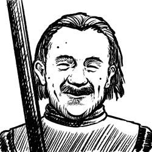
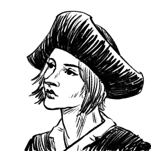
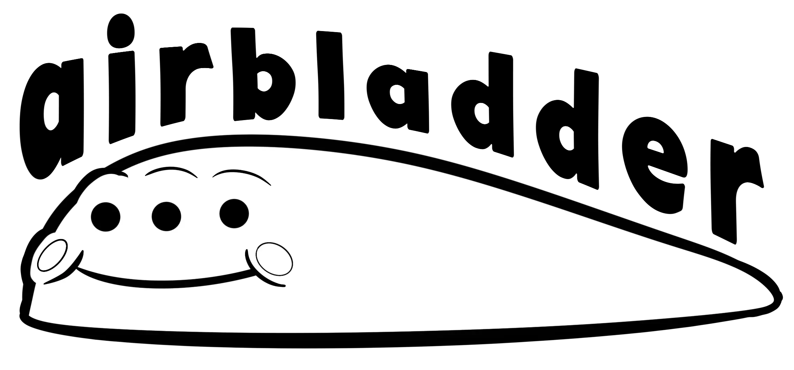
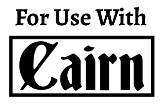

<!--
  Traducción al español de España (es-ES) de README.md, para que coincida con la
  traducción del sistema.

  MANTENIMIENTO: este archivo lo mantiene el proyecto, NO el traductor del
  sistema. La traducción del juego (lang/es.json, lang/content/es.json) es obra
  de un traductor humano; este README es documentación del proyecto y se
  actualiza a mano junto con README.md, que es la versión de referencia.

  Desde el 2026-11-19 la parte de arriba y la de abajo de README.md se generan a
  partir del texto de la ventana de bienvenida (npm run build:readme). Este
  archivo no se genera: es una traducción a mano de todo README.md, y no debe
  contener ninguna sección, dato ni crédito que no esté en el original.

  Terminología: usa siempre lo que el jugador VE en el sistema, es decir
  lang/es.json, no una conjetura de este archivo (Warden -> "Guardián",
  Dashboard -> "Panel del Guardián", Marketplace -> "Mercado"). El resto está en
  tools/i18n/glossary.tsv. Los nombres propios, ediciones (Cairn 2e, Barebones)
  y licencias no se traducen.
-->
<h1 align="center"> Air Bladder™ </h1>
<p align="center">de <a href="https://github.com/domfortunato">Dom Bosco</a><br>Traducción al español de <a href="https://github.com/fsmalecho">Malecho</a></p>

<p align="center"><a href="README.md">English</a> · <b>Español</b></p>

<p align="center"><sub>Esta traducción puede estar desactualizada; el README en inglés es la versión de referencia.</sub></p>

<p align="center"><em>Air Bladder es un sistema no oficial para Foundry VTT, hecho por aficionados, para Cairn 2e y Cairn Barebones.<br>No es el sistema oficial de Cairn, y Yochai Gal no lo ha respaldado.</em></p>

## Hecho para Cairn 2e y para tus propias reglas

- **Cairn 2e viene incluido.** Sus 20 trasfondos, sus tablas y su equipo vienen con el sistema, y puedes leer sus reglas básicas en Foundry.
- **Cairn Barebones también viene incluido.** Sus 100 trasfondos vienen con el sistema. Un personaje de Barebones juega con las mismas reglas que uno de 2e; solo cambia cómo se crea.
- **Trasfondos personalizados.** Escribe tus propios trasfondos de 2e en un compendio del mundo y ofrécelos junto a los oficiales. Los siete trasfondos de clase de Backgrounds for Cairn, de Gordon McCormick, vienen con el sistema.

## Cairn es gratis. ¡Pero puedes comprar los libros!

Cairn lo escribió Yochai Gal. Puedes descargar los libros de reglas gratis, o comprar en papel los libros de reglas y de aventuras de Cairn.

- **Cairn**: [PDF](https://cairnrpg.com/second-edition/game-files/) · [En papel](https://cairnrpg.com/second-edition/print-copies/) · [Tienda](https://cairnrpg.com/store/books/)

Este sistema ya incluye las reglas de Cairn 2e: no necesitas comprar ni subir nada más para jugar a Cairn 2e con él.

## Uso de IA

- 🖌️ **Nada de arte hecho con IA.** Air Bladder incluye más de 2.900 recursos artísticos hechos por personas (retratos, tokens e iconos) y nunca usará arte generado por IA.
- 📜 **Nada de texto de juego hecho con IA.** Ninguna descripción de trasfondo, tabla, conjuro, objeto o monstruo la ha escrito una IA.
- 🧠 **El código de Air Bladder se escribe con la ayuda de un asistente de programación con IA.**

## Requisitos e instalación

**Requiere Foundry VTT v14.368 o superior.**

En Foundry, en **Game Systems → Install System**, pega la URL del manifiesto:

```
https://github.com/domfortunato/air-bladder/releases/latest/download/system.json
```

## Qué incluye

- Generación aleatoria de personajes a partir de trasfondos de Cairn 2e, de Cairn Barebones y personalizados, con cualquier parte suelta que se puede volver a tirar; o una hoja vacía con las listas de selección preparadas, si tiras en la mesa.
- Generadores de PNJ, seguidores, monstruos y facciones, y tablas de encuentros con «Añadir a la escena» en un clic.
- El Panel del Guardián: las 45 tablas de tiradas del Guardián en botones, el reloj de las guardias y el clima del día.
- Dos hacks opcionales, cada uno tras un interruptor del Guardián: el hack oficial de Magia GLOG, con sus 100 conjuros, y el calendario y las estaciones de Vald.
- Un Mercado, vínculos y tablas de tiradas personalizables. Tus copias sobreviven a cada actualización.
- Importación de personajes desde Kettlewright, la aplicación oficial de Cairn.
- Hojas de personaje imprimibles: el personaje entero en una o dos páginas.
- Tres galerías de retratos, y más de 2.900 piezas de arte hechas por personas.
- Una guía de cada función, en el compendio System Docs.
- La interfaz y el contenido del juego en español; se buscan traductores (consulta [TRANSLATING.md](docs/TRANSLATING.md), en inglés).

## Licencias

<details><summary><b>Cairn: CC BY-SA 4.0</b></summary>

Las reglas, los trasfondos, las tablas y el texto de Cairn 2e y Cairn Barebones son de Yochai Gal, con licencia <a href="https://creativecommons.org/licenses/by-sa/4.0/deed.es">Creative Commons Atribución-CompartirIgual 4.0</a>.

</details>
<details><summary><b>Backgrounds for Cairn: CC BY-SA 4.0</b></summary>

Los siete trasfondos de clase del compendio Custom son de Backgrounds for Cairn, de Gordon McCormick, con licencia <a href="https://creativecommons.org/licenses/by-sa/4.0/deed.es">Creative Commons Atribución-CompartirIgual 4.0</a>.

</details>
<details><summary><b>Magia GLOG: CC BY-SA 4.0</b></summary>

Los conjuros GLOG, la tabla de percances y los diarios de Magia GLOG son del hack oficial de Magia GLOG para Cairn, publicado en cairnrpg.com, con licencia <a href="https://creativecommons.org/licenses/by-sa/4.0/deed.es">Creative Commons Atribución-CompartirIgual 4.0</a>.

</details>
<details><summary><b>Licencias del arte</b></summary>

- [Retratos, tokens y monstruos](https://linktr.ee/lydiadidmyink), Lydia Comer: [CC BY-NC-SA 4.0](https://creativecommons.org/licenses/by-nc-sa/4.0/deed.es)
- [Lemur's Portraits](https://jonaspeheim.itch.io/lemurs-portraits), Jon Aspeheim: [CC BY 4.0](https://creativecommons.org/licenses/by/4.0/deed.es)
- [Tlomdev's Tokens](https://tlomdev.itch.io/tlomdevs-tokens), tlomdev: [CC BY-SA 4.0](https://creativecommons.org/licenses/by-sa/4.0/deed.es)
- [Game-icons.net](https://game-icons.net), muchos artistas, cada uno acreditado en icons/CREDITS.md y art/game-icons/CREDITS.md: [CC BY 3.0](https://creativecommons.org/licenses/by/3.0/deed.es)
- [Los dos retratos junto al título](https://linktr.ee/lydiadidmyink), Lydia Comer: [CC BY-NC-SA 4.0](https://creativecommons.org/licenses/by-nc-sa/4.0/deed.es)
- [El logotipo de Air Bladder](https://linktr.ee/lydiadidmyink), Lydia Comer: todos los derechos reservados
- [El sello «For Use With Cairn»](https://cairnrpg.com/resources/logos), Yochai Gal: [CC BY-SA 4.0](https://creativecommons.org/licenses/by-sa/4.0/deed.es)
- [Las fuentes Alegreya](https://github.com/huertatipografica/Alegreya), The Alegreya Project Authors: [SIL OFL 1.1](https://openfontlicense.org/)

</details>

Para más detalle, consulta [LICENSE.txt](LICENSE.txt) (en inglés).

> «Air Bladder» (vejiga de aire) es el primer objeto de la tabla de equipo de la p. 17 de la Guía del jugador de Cairn 2e.

<p align="right"><picture><source media="(prefers-color-scheme: dark)" srcset="art/lydia-comer/Airbladder06.webp"></picture> </p>
