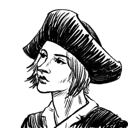
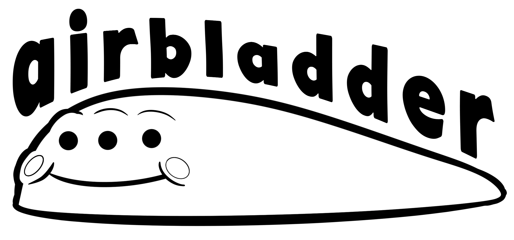
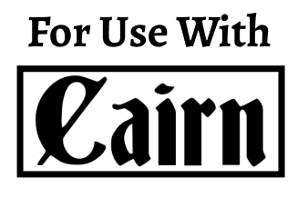

<!-- welcome:start (generated by `npm run build:readme` from lang/en.json and module/welcome-data.js: edit those, not this) -->
<h1 align="center"> Air Bladder™ </h1>
<p align="center">by <a href="https://github.com/domfortunato">Dom Bosco</a><br>Spanish translation by <a href="https://github.com/fsmalecho">Malecho</a></p>

<p align="center"><b>English</b> · <a href="README.es.md">Español</a></p>

<p align="center"><em>Air Bladder is an unofficial, fan-made Foundry VTT system for Cairn 2e and Cairn Barebones.<br>It is not the official Cairn system, and Yochai Gal has not endorsed it.</em></p>

## Built for Cairn 2e and Home Brew

- **Cairn 2e is built in.** Its 20 backgrounds, its tables and its gear come with the system, and you can read its core rules in Foundry.
- **Cairn Barebones is built in too.** Its 100 backgrounds come with the system. A Barebones character plays by the same rules as a 2e one; only how you make it is different.
- **Custom backgrounds.** Write your own 2e backgrounds in a world compendium and offer them beside the official ones. The seven class backgrounds from Gordon McCormick's Backgrounds for Cairn come with the system.

## Cairn is free. But you can buy the books!

Cairn was written by Yochai Gal. You can download the rulebooks for free or buy Cairn rule and adventure books in print.

- **Cairn**: [PDFs](https://cairnrpg.com/second-edition/game-files/) · [In print](https://cairnrpg.com/second-edition/print-copies/) · [Store](https://cairnrpg.com/store/books/)

This system already has the Cairn 2e rules and you do not need to buy or upload anything else to use it to play Cairn 2e.

## AI disclosure

- 🖌️ **No AI art.** Air Bladder ships with more than 2,900 human-made art assets (portraits, tokens and icons) and will never use AI-generated art.
- 📜 **No AI game text.** No background, table, spell, item or monster description was written by AI.
- 🧠 **Air Bladder's code is written with the help of an AI coding assistant.**

<!-- welcome:end -->

## Requirements & Installation

**Requires Foundry VTT v14.368 or higher.**

In Foundry's **Game Systems → Install System**, paste the manifest URL:

```
https://github.com/domfortunato/air-bladder/releases/latest/download/system.json
```

## What you get

- Random character generation from Cairn 2e, Cairn Barebones and custom backgrounds, with any single part re-rollable; or an empty sheet with the pick-lists ready, if you roll at the table.
- NPC, hireling, monster and faction generators, and encounter tables with one-click Add to Scene.
- The Warden's Dashboard: all 45 Warden roll tables on buttons, the calendar bar and the day's weather.
- Two optional hacks, each behind a Warden switch: the official GLoG Magic hack with all 100 spells, and Vald's calendar and seasons.
- A customizable marketplace, bonds and roll tables. Your copies survive every update.
- Character import from Kettlewright, the official Cairn app.
- Printable character sheets: the whole character on one or two pages.
- Three portrait galleries, and more than 2,900 pieces of human-made art.
- A guide to every feature, in the System Docs compendium.
- The interface and the game content in Spanish; translators welcome (see [TRANSLATING.md](docs/TRANSLATING.md)).

<!-- licensing:start (generated by `npm run build:readme` from lang/en.json and module/welcome-data.js: edit those, not this) -->
## Licensing

<details><summary><b>Cairn: CC BY-SA 4.0</b></summary>

The Cairn 2e and Cairn Barebones rules, backgrounds, tables and text are by Yochai Gal, licensed under <a href="https://creativecommons.org/licenses/by-sa/4.0/">Creative Commons Attribution-ShareAlike 4.0</a>.

</details>
<details><summary><b>Backgrounds for Cairn: CC BY-SA 4.0</b></summary>

The seven class backgrounds in the Custom compendium are from Backgrounds for Cairn by Gordon McCormick, licensed under <a href="https://creativecommons.org/licenses/by-sa/4.0/">Creative Commons Attribution-ShareAlike 4.0</a>.

</details>
<details><summary><b>GLOG Magic: CC BY-SA 4.0</b></summary>

The GLOG spells, the Mishaps table and the GLOG Magic journals are from the official Cairn GLOG Magic hack on cairnrpg.com, licensed under <a href="https://creativecommons.org/licenses/by-sa/4.0/">Creative Commons Attribution-ShareAlike 4.0</a>.

</details>
<details><summary><b>Art licensing</b></summary>

- [Portraits, tokens and monsters](https://linktr.ee/lydiadidmyink), Lydia Comer: [CC BY-NC-SA 4.0](https://creativecommons.org/licenses/by-nc-sa/4.0/)
- [Lemur's Portraits](https://jonaspeheim.itch.io/lemurs-portraits), Jon Aspeheim: [CC BY 4.0](https://creativecommons.org/licenses/by/4.0/)
- [Tlomdev's Tokens](https://tlomdev.itch.io/tlomdevs-tokens), tlomdev: [CC BY-SA 4.0](https://creativecommons.org/licenses/by-sa/4.0/)
- [Game-icons.net](https://game-icons.net), many artists, each credited in icons/CREDITS.md and art/game-icons/CREDITS.md: [CC BY 3.0](https://creativecommons.org/licenses/by/3.0/)
- [The two portraits beside the title](https://linktr.ee/lydiadidmyink), Lydia Comer: [CC BY-NC-SA 4.0](https://creativecommons.org/licenses/by-nc-sa/4.0/)
- [The Air Bladder logo](https://linktr.ee/lydiadidmyink), Lydia Comer: all rights reserved
- [The "For Use With Cairn" stamp](https://cairnrpg.com/resources/logos), Yochai Gal: [CC BY-SA 4.0](https://creativecommons.org/licenses/by-sa/4.0/)
- [Alegreya fonts](https://github.com/huertatipografica/Alegreya), The Alegreya Project Authors: [SIL OFL 1.1](https://openfontlicense.org/)

</details>

For more detail see [LICENSE.txt](LICENSE.txt).

> 'Air Bladder' is the first item in the Gear table on p. 17 of the Cairn 2e Player's Guide.

<p align="right"><picture><source media="(prefers-color-scheme: dark)" srcset="art/lydia-comer/Airbladder06.webp"></picture> </p>

<!-- licensing:end -->
